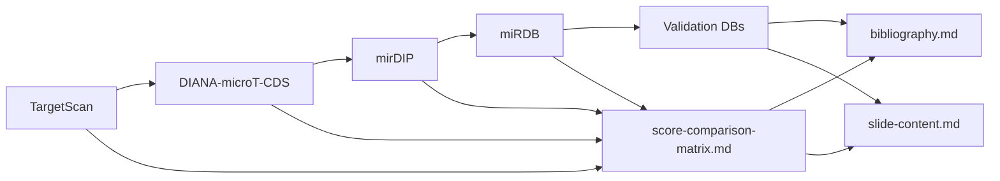

# Research Plan

Roadmap for miRNA target-prediction algorithm research.

Project context: [`miRNA project.pdf`](../../miRNA%20project.pdf)

Checklists: [deep-dive-checklists.md](../../.cursor/skills/mirna-algorithm-research/deep-dive-checklists.md)

Score matrix: [score-comparison-matrix.md](score-comparison-matrix.md)

Presentation: [slide-content.md](../presentation/slide-content.md) · [assets](../presentation/assets/)

**Status:** Research execution **complete** (all five resources + cross-cutting deliverables).

---

## Research order

1. [TargetScan](#1-targetscan-highest-priority) — ✅ complete

2. [DIANA-microT-CDS](#2-diana-microt-cds) — ✅ complete

3. [mirDIP](#3-mirdip) — ✅ complete

4. [miRDB](#4-mirdb) — ✅ complete

5. [Validation databases](#5-validation-databases) — ✅ complete

---

## 1. TargetScan (highest priority)

**Profile:** [targetscan.md](targetscan.md) — **complete**

**Deep-dive checklist:** [deep-dive-checklists.md#targetscan](../../.cursor/skills/mirna-algorithm-research/deep-dive-checklists.md#targetscan) — all items checked

### Deliverables

- [x] [targetscan.md](targetscan.md) status → `complete`

- [x] TargetScan rows in [score-comparison-matrix.md](score-comparison-matrix.md)

- [x] Bibliography entries (TS-001–TS-008)

- [x] Slide 5–6 bullets + [`slide06-targetscan-scoring-axes.svg`](../presentation/assets/slide06-targetscan-scoring-axes.svg)

- [x] Integration notes for `R/module_targetscan.R` (CWCS primary; PCT annotation)

---

## 2. DIANA-microT-CDS

**Profile:** [diana-microt-cds.md](diana-microt-cds.md) — **complete**

**Deep-dive checklist:** [deep-dive-checklists.md#diana-microt-cds](../../.cursor/skills/mirna-algorithm-research/deep-dive-checklists.md#diana-microt-cds) — all items checked

### Deliverables

- [x] [diana-microt-cds.md](diana-microt-cds.md) status → `complete`

- [x] DIANA rows in score matrix

- [x] Bibliography entries (DI-001–DI-003)

- [x] Slide 7–8 bullets

- [x] Integration notes for `R/module_diana.R` (threshold 0.7/0.8; microT score)

---

## 3. mirDIP

**Profile:** [mirdip.md](mirdip.md) — **complete**

**Deep-dive checklist:** [deep-dive-checklists.md#mirdip](../../.cursor/skills/mirna-algorithm-research/deep-dive-checklists.md#mirdip) — all items checked

### Deliverables

- [x] [mirdip.md](mirdip.md) status → `complete`

- [x] mirDIP rows in score matrix

- [x] Bibliography entries (DIP-001–DIP-003)

- [x] Slide 10 bullets

- [x] Integration notes for `R/module_mirdip.R` (meta-layer; Score Class filter)

---

## 4. miRDB

**Profile:** [mirdb.md](mirdb.md) — **complete**

**Deep-dive checklist:** [deep-dive-checklists.md#mirdb](../../.cursor/skills/mirna-algorithm-research/deep-dive-checklists.md#mirdb) — all items checked

### Deliverables

- [x] [mirdb.md](mirdb.md) status → `complete`

- [x] miRDB rows in score matrix

- [x] Bibliography entries (MD-001–MD-003)

- [x] Slide 9 bullets

---

## 5. Validation databases

**Profile:** [validation-databases.md](validation-databases.md) — **complete**

**Deep-dive checklist:** [deep-dive-checklists.md#validation-databases](../../.cursor/skills/mirna-algorithm-research/deep-dive-checklists.md#validation-databases) — all items checked

### Deliverables

- [x] [validation-databases.md](validation-databases.md) status → `complete`

- [x] Validation rows in score matrix

- [x] Bibliography entries (VAL-001–VAL-004)

- [x] Slide 11 bullets

- [x] Integration notes for `R/module_validation.R` (`experimental_support` overlay)

---

## Cross-cutting deliverables

| Deliverable | File | Status |

|-------------|------|--------|

| Score matrix filled | [score-comparison-matrix.md](score-comparison-matrix.md) | ✅ |

| "Why naive averaging fails" narrative | score-comparison-matrix.md | ✅ |

| Bibliography | [bibliography.md](../presentation/sources/bibliography.md) | ✅ |

| TargetScan scoring slide | slide-content.md Slide 6 + asset | ✅ |

| PTEN disagreement slide | slide-content.md Slide 13 + asset | ✅ |

| Side-by-side comparison slide | slide-content.md Slide 12 + asset | ✅ |

| Consensus scoring implications | slide-content.md Slide 15 + asset | ✅ |

| Pros/cons slide | slide-content.md Slide 14 | ✅ |

| Speaker notes | [speaker-notes.md](../presentation/speaker-notes.md) | ✅ |

| Presentation assets (6 SVGs) | [assets/](../presentation/assets/) | ✅ |

---

## Central question (drives all research)

**Why do TargetScan, DIANA, miRDB, and mirDIP give different predictions for the same gene (e.g. PTEN)?**

Documented differences in:

- Candidate-site selection

- Seed-matching rules

- Conservation models

- Thermodynamic calculations

- Accessibility models

- Machine-learning models

- Training datasets

- Scoring systems

- Aggregation methods

- Underlying assumptions

See Slide 13 and [score-comparison-matrix.md](score-comparison-matrix.md).

---

## What this research unlocks

| Downstream work | Status |

|-----------------|--------|

| Slide deck (1–16) | ✅ Content + assets |

| `R/integrate_scores.R` design | Ready — score matrix + integration options documented |

| `R/module_targetscan.R` score selection | Specified in targetscan.md integration notes |

| `R/module_diana.R` threshold | Specified in diana-microt-cds.md |

| `R/module_mirdip.R` tiered design | Specified in mirdip.md |

| `R/module_validation.R` overlay | Specified in validation-databases.md |

---

## Next phase (implementation)

R module implementation against completed research profiles — not part of this research execution phase.

